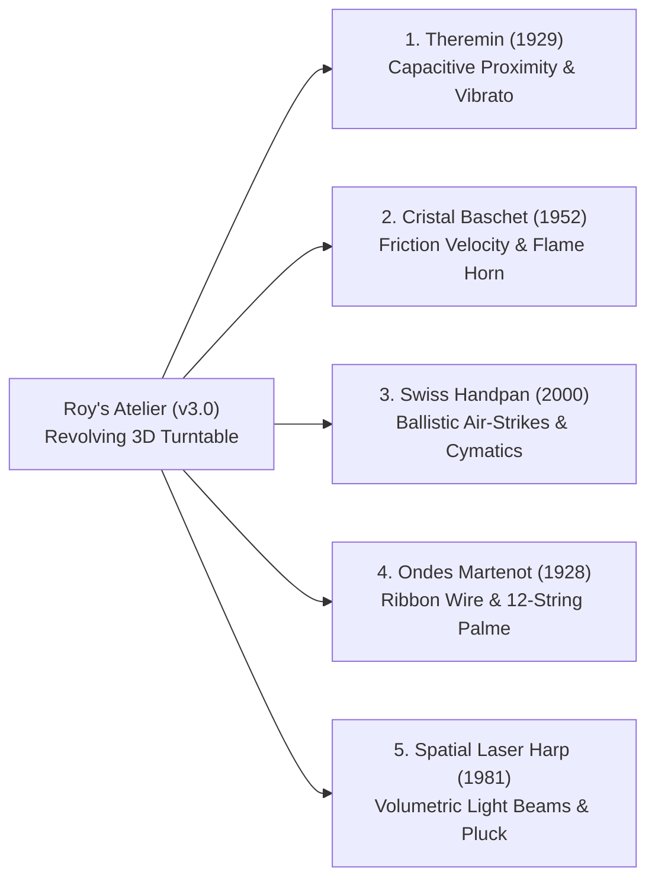

# Roy’s Atelier of Spatial Instruments (v3.0)

> A zero-click, hand-conducted 3D WebGL & Web Audio conservatory featuring **5 rare world instruments** from the Hornbostel–Sachs encyclopedia, powered by **1€ Adaptive Hand Tracking**, **Second-Order Acceleration Kinematics**, and **Mid-Air Overhead Gesture Navigation**.

[](https://roys-theremin.netlify.app)
[](https://www.typescriptlang.org/)
[](https://threejs.org/)
[](https://developers.google.com/mediapipe)
[](https://developer.mozilla.org/en-US/docs/Web/API/Web_Audio_API)

---

## 🌐 Live Experience
Play and conduct the entire conservatory in your browser:  
👉 **[https://roys-theremin.netlify.app](https://roys-theremin.netlify.app)**

---

## 🏛️ The 5 Spatial Instruments

Roy’s Atelier is grounded in organology (the science of musical instruments). Unlike virtual pianos or guitars where lack of physical haptics breaks the illusion, every instrument in Roy’s Atelier produces sound through **free-air spatial proximity, friction velocity, or ballistic acceleration**:



| Instrument | Origin & Taxonomy | Physical Input Mechanism | Acoustic & Synthesis Architecture |
| :--- | :--- | :--- | :--- |
| **1. Moog Etherwave Theremin** | 1929 / 1996 · *Electrophones (Class 5)* | Right hand distance to pitch rod; Left hand elevation above volume loop; Thumb-index pinch vibrato | Heterodyne dual-oscillator with 12AX7 triode waveshaper and 4 selectable formant voices (`Clara`, `Aether`, `Vocal`, `Moog`) |
| **2. Cristal Baschet (*Crystal Organ*)** | 1952 · *Friction Idiophones (131.22)* | Tangential rubbing speed ($s_{\text{rub}} = \|\dot{\mathbf{x}}\|_2$) and circular orbits across 12 horizontal glass rods | Modal waveguide filter bank ($f_0$, $2f_0$, $2.756f_0$ Chladni free-bar modes) with 4-second shimmer release tail |
| **3. Swiss Handpan (*Hang*)** | 2000 · *Harmonic Idiophones (111.24)* | Downward mid-air flick deceleration spikes ($\ddot{\mathbf{x}} > 2.6\text{ m/s}^2$) on 9 steel tone fields; Palm roll ($\hat{\mathbf{n}}_{\text{palm}}$) bends overtones | 8-voice polyphonic modal physical model tuned to **D Kurd 9** in exact PANArt harmonic ratios ($1.0 : 2.0 : 2.998$) |
| **4. Ondes Martenot** | 1928 · *Electro-Acoustic (Class 5)* | Right index ring sliding along horizontal 3D *Ruban* wire ($C_3$ to $C_6$); Left hand *Touche d'Intensité* expression key | Pure *Onde* sine + triangle wave routed through a 12-string sympathetic *Palme* acoustic resonator filter bank |
| **5. Spatial Laser Harp** | 1981 / 2026 · *Optical Chordophone (530)* | 10-fingertip ray interception across 10 upward-diverging laser beams; Crossing velocity $|v_x|$ plucks string | Polyphonic Karplus-Strong & FM plucked synthesis in E Minor 9 / Hirajoshi scale with vertical height filter sweep and pinch pitch-bend |

---

## 👑 Zero-Click Mid-Air Gesture Navigation

The conservatory is designed to be played **completely hands-free without touching a mouse or keyboard**:

1. **Overhead Crown Portal Dwell:**  
   Raise either index finger into the **top Crown Portal zone** ($y_{\text{norm}} < 0.18$) above the 5 stage pills. Moving horizontally selects an instrument; hovering for **0.75 seconds** fills the luminous golden radial progress ring and smoothly rotates the 3D stage to that instrument with a harmonic chime!
2. **Two-Hand "Conductor’s Wrist-Cross" Quick-Cycle:**  
   Cross both wrists in the upper-middle webcam frame ($\|\mathbf{p}_{0,L} - \mathbf{p}_{0,R}\|_2 < 0.12\text{ m}$) for **0.65 seconds** to instantly advance to the next instrument in the carousel.
3. **Horizontal Air-Swipe:**  
   Flick either hand horizontally in the overhead zone ($|v_x| > 0.58\text{ m/s}$) to swipe between adjacent instruments.
4. **Desktop Pointer Mode:**  
   Move your mouse across the stage to test instruments directly, scroll wheel for vibrato/pinch, and click or tap Spacebar to mute or strike tone fields.

---

## 🔬 Mathematical Formulations

### 1. Second-Order Kinematic Observer (`src/math/kinematicObserver.ts`)
For active hand fingertips $\mathbf{p}(t) \in \mathbb{R}^3$, velocity $\mathbf{v}(t)$ is filtered with a 1€ adaptive low-pass filter ($f_{c,\min} = 2.0\text{ Hz}, \beta = 0.08$):

$$\mathbf{v}(t) = \text{OneEuro}\left(\frac{\mathbf{p}(t) - \mathbf{p}(t - \Delta t)}{\Delta t}\right)$$

Instantaneous acceleration $\mathbf{a}_{\text{raw}}(t) = \frac{\mathbf{v}(t) - \mathbf{v}(t - \Delta t)}{\Delta t}$ is smoothed with an exponential observer ($\alpha = 0.35$):

$$\mathbf{a}(t) = \alpha \mathbf{a}_{\text{raw}}(t) + (1 - \alpha) \mathbf{a}(t - \Delta t)$$

### 2. Ballistic Air-Strike Detection (Swiss Handpan)
A strike trigger fires when a downward velocity vector ($v_y < -0.16\text{ m/s}$) is immediately followed by a sharp upward deceleration spike ($a_y > +2.6\text{ m/s}^2$):

$$\text{isStrike}(t) = (v_y(t - \Delta t) < -0.16) \;\land\; (a_y(t) > 2.6)$$
$$\text{velocity} = \text{clamp}\left(\frac{|v_y(t - \Delta t)|}{1.35}, 0.15, 1.0\right)$$

### 3. Tangential Friction Energy (Cristal Baschet)
Continuous stick-slip excitation energy $s_{\text{rub}} \in [0, 1]$ integrates tangential velocity with leaky decay:

$$s_{\text{rub}}(t) = \begin{cases}
s_{\text{rub}}(t - \Delta t) + (e_{\text{target}} - s_{\text{rub}}(t - \Delta t)) \cdot \min(1, 18 \Delta t) & \text{if } e_{\text{target}} > s_{\text{rub}} \\
s_{\text{rub}}(t - \Delta t) \cdot \exp(-6.5 \Delta t) & \text{otherwise}
\end{cases}$$

### 4. 3D Palm Orientation Normal & Wrist Roll
From wrist $\mathbf{p}_0$, index MCP $\mathbf{p}_5$, and pinky MCP $\mathbf{p}_{17}$:

$$\mathbf{u} = \mathbf{p}_5 - \mathbf{p}_0, \quad \mathbf{w} = \mathbf{p}_{17} - \mathbf{p}_0, \quad \hat{\mathbf{n}}_{\text{palm}} = \frac{\mathbf{u} \times \mathbf{w}}{\|\mathbf{u} \times \mathbf{w}\|_2}$$

---

## 🛠️ Local Development & Build

```bash
# Clone repository
git clone https://github.com/Royverse/roys-theremin.git
cd roys-theremin

# Install dependencies
npm install

# Run strict TypeScript verification
npm run typecheck

# Start local development server
npm run dev

# Build production bundle
npm run build
```

---

## 📜 License
MIT License © 2026 Royverse
